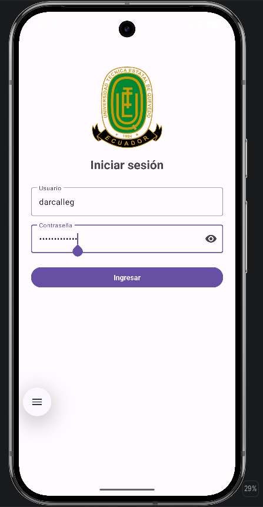

# Práctica 01 – App Móvil: Login simple (UTEQ)

Aplicación Android desarrollada en **Java** como práctica de la asignatura de Aplicaciones Móviles (Semestre 6) de la **Universidad Técnica Estatal de Quevedo (UTEQ)**.

La app muestra una pantalla de inicio de sesión con el logo institucional. Valida los campos de usuario y contraseña y, si las credenciales son correctas, abre una pantalla principal que da la bienvenida al usuario.

## Funcionalidades

- Pantalla de **inicio de sesión** con el logo de la UTEQ.
- Campos de **Usuario** y **Contraseña** con estilo Material 3 (`TextInputLayout` con borde).
- Botón para **mostrar u ocultar la contraseña** (ícono del ojo).
- **Validación de campos vacíos**: muestra un error debajo de cada campo ("Ingrese el usuario" / "Ingrese la contraseña").
- **Validación de credenciales**: si son incorrectas, muestra un `Toast` ("Usuario o contraseña incorrectos") y limpia la contraseña.
- Si el login es correcto, abre `MainActivity` con el mensaje **"¡Bienvenido, &lt;usuario&gt;!"** y un banner de la UTEQ.
- Al entrar se cierra el login (`finish()`), así el botón *Atrás* no regresa a esa pantalla.
- Diseño *edge-to-edge*, que ajusta la pantalla cuando aparece el teclado.

## Interfaz realizada

### Pantalla de inicio de sesión

<p align="center">
  
</p>

Elementos de la pantalla (definidos en [`activity_login.xml`](app/src/main/res/layout/activity_login.xml)):

| Elemento | Componente | Descripción |
|---|---|---|
| Logo UTEQ | `ImageView` | Escudo de la universidad (`@drawable/icon_uteq`), 160×160 dp |
| Título | `TextView` | "Iniciar sesión", 24sp en negrita |
| Usuario | `TextInputLayout` + `TextInputEditText` | Campo de texto con borde |
| Contraseña | `TextInputLayout` + `TextInputEditText` | Campo oculto con botón para mostrar/ocultar (`password_toggle`) |
| Ingresar | `Button` | Ejecuta la validación e inicia sesión |

Todo está dentro de un `ScrollView` con un `LinearLayout` vertical centrado, para que se pueda desplazar cuando el teclado está abierto.

## Credenciales de prueba

El login es simple, sin base de datos. Las credenciales están definidas en el código de [`LoginActivity.java`](app/src/main/java/com/practica01S2/LoginActivity.java):

| Usuario | Contraseña |
|---|---|
| `admin` | `1234` |

## Estructura del proyecto

```
app/src/main/
├── AndroidManifest.xml              # LoginActivity es la pantalla de inicio (LAUNCHER)
├── java/com/practica01S2/
│   ├── LoginActivity.java           # Lógica del login y validaciones
│   └── MainActivity.java            # Pantalla de bienvenida
└── res/
    ├── drawable/                    # Logo e imágenes de la UTEQ
    ├── layout/
    │   ├── activity_login.xml       # Interfaz del login
    │   └── activity_main.xml        # Interfaz de bienvenida
    └── values/strings.xml           # Textos de la app (en español)
```

## Flujo de la aplicación

```
LoginActivity ──(usuario y contraseña correctos)──► MainActivity ("¡Bienvenido, admin!")
      │
      └──(campos vacíos o datos incorrectos)──► Mensaje de error y se queda en el login
```

## Tecnologías

- **Lenguaje:** Java 11
- **IDE:** Android Studio
- **Build:** Gradle (Kotlin DSL) con catálogo de versiones (`libs.versions.toml`)
- **SDK:** `minSdk 34`, `targetSdk 37`, `compileSdk 37`
- **Librerías:** AppCompat, Material Components, ConstraintLayout, Activity KTX
- **Pruebas:** JUnit 4, AndroidX Test, Espresso

## Cómo ejecutar

1. Clonar el repositorio:
   ```bash
   git clone https://github.com/darcalleg-soft/PRACTICA01-S2-APPMOVIL.git
   ```
2. Abrir la carpeta en **Android Studio** y esperar a que Gradle sincronice.
3. Ejecutar la app en un emulador o dispositivo con **Android 14 (API 34)** o superior.
4. Iniciar sesión con `admin` / `1234`.
